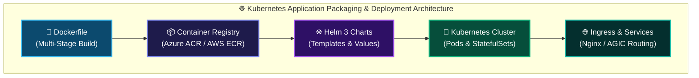
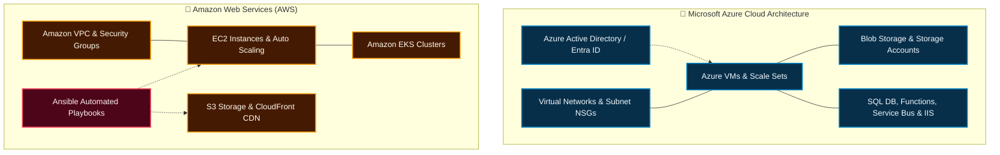

```mermaid
flowchart TD
    subgraph CorePillars ["🛠️ 10 DevOps & Cloud Engineering Pillars"]
        direction LR
        P1["⚡ 1. Terraform IaC<br/>• Reusable Modules<br/>• State Locking & Drift"]
        P2["🚀 2. Azure Pipelines<br/>• Multi-Stage YAML<br/>• Quality Gates & PRs"]
        P3["🐳 3. Docker Engine<br/>• Multi-Stage Builds<br/>• Non-Root Images"]
        P4["☸️ 4. Kubernetes<br/>• AKS / EKS Clusters<br/>• Helm & StatefulSets"]
        P5["🐙 5. GitOps & Argo CD<br/>• Declarative Delivery<br/>• Git-Driven Sync"]
        P6["☁️ 6. Cloud Platforms<br/>• Azure & AWS (EC2/EKS)<br/>• VNets, VPC & Endpoints"]
        P7["📜 7. Ansible Automation<br/>• Reusable Playbooks<br/>• Cloud & OS Config"]
        P8["📊 8. Observability<br/>• Prometheus & Grafana<br/>• Metrics & Alerting"]
        P9["🐧 9. Linux & Systems<br/>• RHEL / Ubuntu Hardening<br/>• Bash & Python Scripts"]
        P10["🔒 10. Cloud Security<br/>• Azure Key Vault & AD<br/>• Shift-Left Scanning"]
    end

    P1 <--> P2 <--> P3 <--> P4 <--> P5
    P5 <--> P6 <--> P7 <--> P8 <--> P9 <--> P10

    classDef c1 fill:#082f49,stroke:#38bdf8,stroke-width:2px,color:#f0f9ff;
    classDef c2 fill:#2e1065,stroke:#a855f7,stroke-width:2px,color:#faf5ff;
    classDef c3 fill:#064e3b,stroke:#10b981,stroke-width:2px,color:#f0fdf4;
    classDef c4 fill:#0c4a6e,stroke:#0ea5e9,stroke-width:2px,color:#f0f9ff;
    classDef c5 fill:#3b0764,stroke:#c084fc,stroke-width:2px,color:#faf5ff;
    classDef c6 fill:#451a03,stroke:#f59e0b,stroke-width:2px,color:#fffbeb;
    classDef c7 fill:#042f2e,stroke:#14b8a6,stroke-width:2px,color:#f0fdfa;
    classDef c8 fill:#1a2e05,stroke:#84cc16,stroke-width:2px,color:#f7fee7;
    classDef c9 fill:#4c0519,stroke:#f43f5e,stroke-width:2px,color:#fff1f2;
    classDef c10 fill:#042c33,stroke:#06b6d4,stroke-width:2px,color:#ecfeff;

    class P1 c1;
    class P2 c2;
    class P3 c3;
    class P4 c4;
    class P5 c5;
    class P6 c6;
    class P7 c7;
    class P8 c8;
    class P9 c9;
    class P10 c10;
```

<div align="center">

<!-- ANIMATED HERO BANNER -->


<br/>

# Sarvesh Kumar Mishra
### **Senior DevOps Engineer &bull; CI/CD &bull; Terraform &bull; Kubernetes &bull; GitOps &bull; Azure DevOps**
**15+ Years Total IT Experience | 6+ Years Specializing in Cloud DevOps, Terraform & Kubernetes**

[](https://www.linkedin.com/in/sarveshkumarmishra)
[](mailto:mishrasarvesh7@gmail.com)
[](#-get-in-touch--lets-collaborate)
[](#-professional-summary--technical-focus)

<p align="center">
  <b>Automating Infrastructure with Terraform &bull; Multi-Stage CI/CD via Azure Pipelines &bull; Kubernetes (AKS/EKS) &amp; GitOps (Argo CD) &bull; Enterprise Linux &amp; Observability (Prometheus/Grafana)</b>
</p>

---

</div>

## 📌 Professional Summary & Technical Focus

I am a **Senior DevOps & Cloud Engineer** with **15+ years of overall IT experience**, including **6+ years dedicated to cloud DevOps, infrastructure automation, and container orchestration** across enterprise environments (currently at **Ericsson India Global Services**).

My core technical strengths center on **hands-on implementation, reliability, and automation**:
* **Infrastructure as Code (IaC):** Developing modular, reusable **Terraform** configurations with remote state management and ARM templates across **Microsoft Azure** and **AWS**.
* **CI/CD & GitOps Automation:** Architecting multi-stage YAML pipelines in **Azure DevOps (Azure Pipelines)**, **Jenkins**, and **GitHub Actions**, alongside declarative continuous delivery using **Argo CD**.
* **Containerization & Orchestration:** Building hardened **Docker** images and orchestrating **Kubernetes (AKS / EKS)** clusters leveraging **Helm charts**, StatefulSets, and Ingress controllers.
* **Configuration Management:** Writing **Ansible** playbooks to automate infrastructure configurations across cloud compute (EC2/VMs), storage (S3/Blob), and CDN services.
* **Observability & Telemetry:** Establishing full-stack monitoring using **Prometheus and Grafana** for real-time infrastructure metrics, health dashboards, and alert routing.
* **Enterprise Linux Administration:** Deep background in enterprise Linux fleets (**RHEL, Ubuntu, CentOS**), OS hardening, shell scripting (**Bash**), and **Python** automation.

<br/>

<div align="center">

<!-- VIBRANT VISUAL: STRATEGIC DEVSECOPS PORTFOLIO -->


</div>

<br/>

> **Engineering Philosophy:** *"If infrastructure is deployed more than once, it must be codified in Terraform. If software moves to production, it must pass automated CI/CD and security gates. If workloads scale, they belong in resilient, observable Kubernetes clusters."*

---

## ⚡ Core Technical Delivery Metrics

| Area | Engineering Value & Scale Delivered | Primary Technologies |
|:---|:---|:---|
| **15+ Years** | Solid foundation in enterprise systems engineering, Linux administration, storage, and networking | Linux (RHEL, Ubuntu), Systems Engineering |
| **6+ Years** | Hands-on Cloud DevOps engineering, CI/CD design, and infrastructure automation at Ericsson | Azure DevOps, Terraform, Kubernetes |
| **Terraform IaC** | Modularized cloud provisioning across Azure and AWS with remote state locking and zero state drift | Terraform, Azure Blob, AWS S3, ARM |
| **CI/CD & GitOps** | Automated multi-stage YAML release pipelines and declarative GitOps synchronization | Azure Pipelines, Jenkins, GitHub Actions, Argo CD |
| **Kubernetes (AKS/EKS)** | Production cluster deployments with Helm 3, StatefulSets, Ingress routing, and autoscaling | Kubernetes, Docker, AKS, EKS, Helm 3 |
| **Observability & SRE** | Full-stack monitoring, alert routing, and custom dashboards for critical infrastructure uptime | Prometheus, Grafana, Azure Monitor |

---

## 🏛️ The 10 DevOps & Cloud Engineering Pillars

These ten pillars represent my practical technical foundation across everyday engineering and infrastructure delivery:

<div align="center">

<!-- VIBRANT VISUAL: 10 DEVSECOPS & CLOUD PILLARS -->


</div>

<br/>



---

## 🏗️ Technical Deep-Dive: Infrastructure as Code (Terraform & ARM)

Automating cloud infrastructure provisioning with modular, reusable IaC configurations across **Microsoft Azure** and **AWS**:

```mermaid
flowchart LR
    T1["📦 Terraform Module Repo<br/>(Git Versioned & Tagged)"] --> T2["🔍 Code Quality & Formatting<br/>(terraform fmt & tflint)"]
    T2 --> T3["🛡️ Pre-Commit Security<br/>(Checkov & tfsec Scans)"]
    T3 --> T4["📋 Remote State Plan<br/>(Azure Blob Lease Locked)"]
    T4 --> T5["👥 PR Review & Approval<br/>(CODEOWNERS Enforcement)"]
    T5 --> T6["🚀 Automated Deployment<br/>(Dev / Stage / Prod)"]

    classDef tf1 fill:#1e1b4b,stroke:#818cf8,stroke-width:2px,color:#fff;
    classDef tf2 fill:#0c4a6e,stroke:#38bdf8,stroke-width:2px,color:#fff;
    classDef tf3 fill:#064e3b,stroke:#10b981,stroke-width:2px,color:#fff;
    classDef tf4 fill:#2e1065,stroke:#a855f7,stroke-width:2px,color:#fff;
    classDef tf5 fill:#7f1d1d,stroke:#ef4444,stroke-width:2px,color:#fff;
    classDef tf6 fill:#042f2e,stroke:#14b8a6,stroke-width:2px,color:#fff;

    class T1 tf1;
    class T2 tf2;
    class T3 tf3;
    class T4 tf4;
    class T5 tf5;
    class T6 tf6;
```



### Production Terraform Best Practices:
* **Reusable Modular Architecture:** Designing parameterized modules for VNets, Subnets, AKS, Key Vault, Storage Accounts, and AWS VPC/EKS with strict input variables and outputs.
* **Remote State Management:** Securing state files with blob lease locking in private Azure Storage Accounts and AWS S3 with DynamoDB, preventing concurrent state corruption.
* **Multi-Environment Isolation:** Structuring separate state boundaries for `dev`, `stage`, and `prod` to prevent blast radius across environments.
* **Automated Drift Detection:** Scheduled night pipelines running `terraform plan -detailed-exitcode` to immediately flag any manual modifications made in cloud consoles.
* **Azure Resource Manager (ARM):** Utilizing ARM templates for specialized Azure provisioning, updates, and compliance enforcement.

---

## 🚀 Technical Deep-Dive: CI/CD Pipelines & GitOps (Argo CD)

Building automated software delivery pipelines using **Azure Pipelines (YAML)**, **Jenkins**, **GitHub Actions**, and **Argo CD**:

```mermaid
flowchart LR
    A["💻 Git Commit / PR<br/>(Trunk-Based)"] --> B["🔍 Build & Lint<br/>(Unit Tests & tflint)"]
    B --> C["🛡️ Shift-Left Security<br/>(Gitleaks & Trivy Scans)"]
    C --> D["🐳 Container Build<br/>(Docker Push to ACR/ECR)"]
    D --> E["🐙 GitOps Manifest Update<br/>(Helm / YAML Repo)"]
    E --> F["⚙️ Argo CD Auto-Sync<br/>(Declarative State Match)"]
    F --> G["☸️ Kubernetes Cluster<br/>(AKS Deployment Live)"]

    classDef cGit fill:#4c0519,stroke:#f43f5e,stroke-width:2px,color:#ffffff;
    classDef cLint fill:#1e1b4b,stroke:#6366f1,stroke-width:2px,color:#ffffff;
    classDef cSec fill:#064e3b,stroke:#10b981,stroke-width:2px,color:#ffffff;
    classDef cBuild fill:#451a03,stroke:#f59e0b,stroke-width:2px,color:#ffffff;
    classDef cGitOps fill:#3b0764,stroke:#c084fc,stroke-width:2px,color:#ffffff;
    classDef cArgo fill:#082f49,stroke:#0284c7,stroke-width:2px,color:#ffffff;
    classDef cK8s fill:#042f2e,stroke:#14b8a6,stroke-width:2px,color:#ffffff;

    class A cGit;
    class B cLint;
    class C cSec;
    class D cBuild;
    class E cGitOps;
    class F cArgo;
    class G cK8s;
```



### CI/CD & Pipeline Governance:
* **Azure Pipelines (YAML):** Multi-stage pipelines orchestrating automated builds, artifact creation, approval environments, and release gates.
* **GitOps Delivery with Argo CD:** Implementing declarative continuous delivery by watching Git repositories and synchronizing live Kubernetes cluster states.
* **Git Workflow Enforcement:** Trunk-based development with short-lived feature branches (`feature/*`, `fix/*`), resolving merge conflicts, and mandatory PR reviews.
* **Automated Security Gates:** Incorporating pre-commit secret detection (**Gitleaks**) and container vulnerability scanning (**Trivy**) prior to registry push.

---

## ☸️ Technical Deep-Dive: Docker, Kubernetes & Helm (AKS / EKS)

Experience deploying, maintaining, and scaling microservice workloads across **Kubernetes (AKS and EKS)**:



### Kubernetes & Container Competencies:
* **Docker Packaging:** Crafting lean, multi-stage Dockerfiles that run as non-root service users to minimize attack surfaces and build times.
* **Kubernetes Workload Management:** Provisioning and maintaining Pods, Deployments, **StatefulSets**, ConfigMaps, Secrets, and Services (ClusterIP, NodePort, LoadBalancer).
* **Helm 3 Chart Engineering:** Parameterizing deployments using structured Helm charts with environment overlays (`values-dev.yaml`, `values-prod.yaml`).
* **Ingress & Traffic Control:** Configuring Ingress Controllers with TLS termination and path-based routing.
* **Resource Optimization:** Enforcing CPU/Memory resource `requests` and `limits`, health checks (liveness/readiness probes), and Horizontal Pod Autoscalers (HPA).

---

## ☁️ Cloud Platforms: Microsoft Azure & Amazon AWS

Hands-on administration and automation across public cloud infrastructures:



### Cloud Services Administered:
* **Microsoft Azure:** Azure Active Directory (AAD / Entra ID), Virtual Machines, Storage Accounts (Blob), SQL Database, Azure Functions, Service Bus, Service Fabric, and IIS web hosting.
* **Amazon AWS:** Provisioning and managing EKS clusters, EC2 instances, VPC networking, S3 buckets, and CloudFront distributions via Terraform.
* **Configuration with Ansible:** Authoring automated Ansible playbooks for EC2, S3, and operating system configuration across distributed server fleets.
* **Network & Perimeter Security:** Configuring Network Security Groups (NSGs), Security Groups, Private Endpoints, and VPN connectivity to eliminate public exposures.

---

## 📊 Observability, Linux Administration & SRE Practices

Ensuring high availability, platform reliability, and fast incident recovery across physical and virtualized server fleets:

| Domain | Tools & Implementation Practices |
|:---|:---|
| **Monitoring & Metrics** | **Prometheus and Grafana** deployed for real-time infrastructure telemetry, custom node exporter metrics, and visual dashboarding. |
| **Enterprise Alerting** | Automated alert rules triggering notifications for CPU/Memory thresholds, container pod crash-loops, and disk space exhaustion. |
| **Linux Administration** | Deep troubleshooting across **RHEL, Ubuntu, and CentOS**, kernel parameters, systemd services, LVM disk resizing, and filesystem management (NFS, Samba, iSCSI). |
| **Shell & Automation Scripting** | Authoring production **Bash (Shell)** and **Python** automation scripts for backup verification, log rotation, and server health audits. |
| **Patch Lifecycle Management** | Automated OS patching and security baseline updates utilizing Red Hat Satellite and package managers (`YUM`/`APT`). |
| **High Availability & DR** | Participating in cross-team disaster recovery (DR) drills, verifying backup automation configurations, and tracking strict SLA targets. |

---

## 🛠️ Comprehensive Technical Skill Spectrum

<div align="center">

### Infrastructure as Code & Automation


### CI/CD, GitOps & Security Tools
-0078D7?style=for-the-badge&logo=azure-devops&logoColor=white)


-EF7B4D?style=for-the-badge&logo=argo&logoColor=white)


### Containers & Orchestration

-326CE5?style=for-the-badge&logo=kubernetes&logoColor=white)


### Cloud Platforms & Enterprise Services


### Observability, OS & Scripting


-FCC624?style=for-the-badge&logo=linux&logoColor=black)


</div>

---

## 📂 Featured Production Blueprints & Repositories

Explore select IaC configurations, CI/CD pipeline templates, and automation modules:

<table>
  <tr>
    <td width="50%">
      <h3>🏛️ <a href="https://github.com/Sarvesh0401/terraform-azure-landing-zone">terraform-azure-landing-zone</a></h3>
      <p>Modular, reusable Terraform configuration provisioning Azure VNets, Subnets, NSGs, and Private Endpoints with remote state locking and tflint validation.</p>
      <code>Terraform</code> &bull; <code>Azure</code> &bull; <code>IaC</code> &bull; <code>Modular</code>
    </td>
    <td width="50%">
      <h3>🛡️ <a href="https://github.com/Sarvesh0401/devsecops-pipeline-accelerator">devsecops-pipeline-accelerator</a></h3>
      <p>Ready-to-use Azure Pipelines (YAML) and GitHub Actions templates embedding shift-left security (Checkov, Trivy, Gitleaks) before approval gates.</p>
      <code>Azure Pipelines</code> &bull; <code>YAML</code> &bull; <code>Checkov</code> &bull; <code>Trivy</code>
    </td>
  </tr>
  <tr>
    <td width="50%">
      <h3>☸️ <a href="https://github.com/Sarvesh0401/aks-helm-deployment-starter">aks-helm-deployment-starter</a></h3>
      <p>Production-ready Helm 3 chart and Kubernetes manifests for microservices on AKS with Ingress routing, health probes, and resource limit baselines.</p>
      <code>Kubernetes</code> &bull; <code>AKS</code> &bull; <code>Helm 3</code> &bull; <code>Docker</code>
    </td>
    <td width="50%">
      <h3>📜 <a href="https://github.com/Sarvesh0401/ansible-cloud-automation">ansible-cloud-automation</a></h3>
      <p>Reusable Ansible playbooks for automated server configuration, OS-level hardening checklists, and AWS infrastructure setup (EC2, S3, CloudFront).</p>
      <code>Ansible</code> &bull; <code>AWS</code> &bull; <code>Linux</code> &bull; <code>Automation</code>
    </td>
  </tr>
</table>

---

## 📊 GitHub Analytics & Engineering Pulse

<div align="center">


<br/>


</div>

---

## 🤝 Get in Touch & Let's Collaborate

I am open to discussions regarding **Senior DevOps & Cloud Engineering**, **Terraform IaC automation**, **Kubernetes orchestration**, and **CI/CD pipeline delivery**:

<div align="center">

[](https://www.linkedin.com/in/sarveshkumarmishra)
[](mailto:mishrasarvesh7@gmail.com)
[](https://github.com/Sarvesh0401)

<br/>

```
"Code it in Terraform. Automate it in Pipelines. Deploy it with GitOps."
```

**Crafted with 🛡️ by Sarvesh Kumar Mishra**

</div>
