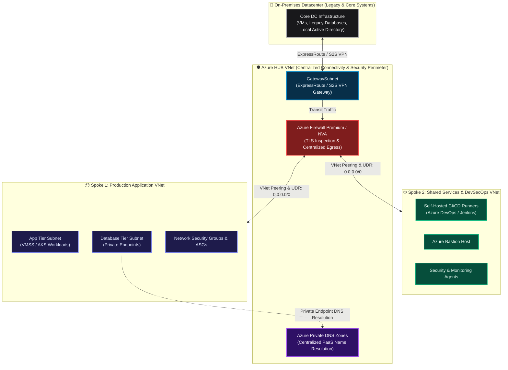
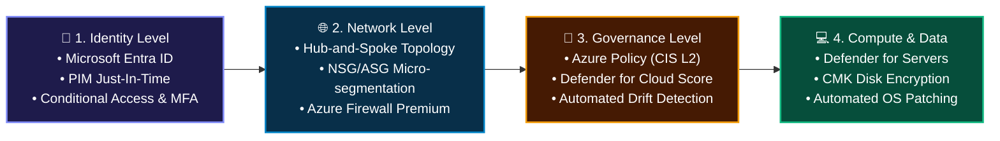
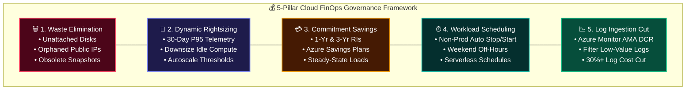

```mermaid
flowchart TD
    subgraph PillarsFlow ["🏛️ Interconnected Enterprise Pillars & Operational Guardrails"]
        direction LR
        P1["⚡ 1. Scalable<br/>• Multi-AZ VMSS<br/>• Auto-Scale Rules"]
        P2["🛡️ 2. Robust<br/>• Chaos Tested<br/>• Self-Healing Pods"]
        P3["🔒 3. Secure<br/>• Zero-Trust & PIM<br/>• CIS L2 Benchmarks"]
        P4["⚙️ 4. Reliable<br/>• 99.99% SLA / SLO<br/>• Predictable Latency"]
        P5["📦 5. Portable<br/>• Docker & AKS/EKS<br/>• Modular Terraform"]
        P6["📜 6. Governed<br/>• Azure Policy Guard<br/>• Auto Drift Detect"]
        P7["🌐 7. High Avail<br/>• Zone-Redundant<br/>• Health Probing"]
        P8["💰 8. Cost-Optim<br/>• FinOps 28% Cut<br/>• Rightsizing & RIs"]
        P9["💾 9. Backed Up<br/>• ASR: RTO < 1h<br/>• ZRS/GRS: RPO < 15m"]
        P10["📊 10. Monitored<br/>• Azure Monitor AMA<br/>• DCR Log Filtering"]
    end

    P1 <--> P2 <--> P3 <--> P4 <--> P5
    P5 <--> P6 <--> P7 <--> P8 <--> P9 <--> P10

    classDef c1 fill:#082f49,stroke:#38bdf8,stroke-width:2px,color:#f0f9ff;
    classDef c2 fill:#2e1065,stroke:#a855f7,stroke-width:2px,color:#faf5ff;
    classDef c3 fill:#064e3b,stroke:#10b981,stroke-width:2px,color:#f0fdf4;
    classDef c4 fill:#0c4a6e,stroke:#0ea5e9,stroke-width:2px,color:#f0f9ff;
    classDef c5 fill:#3b0764,stroke:#c084fc,stroke-width:2px,color:#faf5ff;
    classDef c6 fill:#451a03,stroke:#f59e0b,stroke-width:2px,color:#fffbeb;
    classDef c7 fill:#042f2e,stroke:#14b8a6,stroke-width:2px,color:#f0fdfa;
    classDef c8 fill:#1a2e05,stroke:#84cc16,stroke-width:2px,color:#f7fee7;
    classDef c9 fill:#4c0519,stroke:#f43f5e,stroke-width:2px,color:#fff1f2;
    classDef c10 fill:#042c33,stroke:#06b6d4,stroke-width:2px,color:#ecfeff;

    class P1 c1;
    class P2 c2;
    class P3 c3;
    class P4 c4;
    class P5 c5;
    class P6 c6;
    class P7 c7;
    class P8 c8;
    class P9 c9;
    class P10 c10;
```

<div align="center">

<!-- ANIMATED HERO BANNER -->


<br/>

# Sarvesh Kumar Mishra
### **Senior DevSecOps &bull; Cloud Professional &bull; Technical Lead**
**16+ Years Total IT Experience | 7+ Years Specialized in DevSecOps & Multi-Cloud Platforms**

[](https://www.linkedin.com/in/sarveshkumarmishra)
[](mailto:sarvesh.mishra.devsecops@gmail.com)
[](#-get-in-touch--lets-collaborate)
[](#-executive-profile--career-narrative)

<p align="center">
  <b>Hardening Multi-Cloud Foundations &bull; Shifting Security Left &bull; Accelerating 100+ Workload Enterprise Migrations &bull; Scaling FinOps & Governance</b>
</p>

---

</div>

## 📌 Executive Profile & Career Narrative

I am a **Senior DevSecOps and Cloud Professional** with **16+ years of total IT industry experience**, including **7+ years dedicated to enterprise-scale DevSecOps, multi-cloud platforms, and Infrastructure as Code (IaC)**. 

Throughout my career, I have focused on bridging **enterprise business needs, robust security postures, and engineering velocity**. I specialize in building enterprise Azure and AWS landing zones, executing zero-downtime cloud migrations (100+ multi-tier workloads), hardening defense-in-depth security (CIS/ISO27001), and implementing automated DevSecOps pipelines that shift security left without throttling developer productivity.

<br/>

<div align="center">

<!-- VIBRANT VISUAL: HOW TO STAND OUT / STRATEGIC PORTFOLIO -->


</div>

<br/>

> **The Senior DevSecOps Mindset:** Experienced practitioners do not merely configure tool syntax; we answer the strategic questions: *"What is the business domain? How do we prevent security vulnerabilities before code merges? How do we ensure 99.99% availability while optimizing cloud spend?"* My approach aligns automated infrastructure with organizational compliance, risk mitigation, and measurable ROI.

---

## ⚡ High-Impact Executive Metrics

| Metric | Business & Engineering Value Delivered | Primary Technologies / Domains |
|:---|:---|:---|
| **16+ Years** | Solid track record spanning IT infrastructure engineering, systems administration, and cloud transformation | Enterprise IT & Team Leadership |
| **7+ Years** | Hands-on DevSecOps engineering, automated CI/CD governance, and cloud security hardening | Azure DevOps, GitHub Actions, Jenkins, Checkov, Trivy |
| **100+ Workloads** | Datacenter-to-Azure migration executed with **zero unexpected business downtime** | Azure Migrate, CAF, Hub-and-Spoke, ASR |
| **28%+ OPEX Saved** | Continuous FinOps cost governance via rightsizing, automated scheduling, and log tuning | Infracost, Azure Cost Mgmt, Reserved Instances |
| **100% Guardrails** | Automated drift detection and CIS Level 2 benchmark policy enforcement across environments | Terraform, Azure Policy, Defender for Cloud |
| **99.99% Uptime** | Resilient compute architectures with multi-region disaster recovery (RTO &lt; 1h / RPO &lt; 15m) | VMSS, Azure Site Recovery, ZRS/GRS |

---

## 🏛️ The 10 Scalability & Quality Pillars

Every cloud foundation and landing zone I engineer is built on these ten non-negotiable architectural and operational pillars:

<div align="center">

<!-- VIBRANT VISUAL: 10 SCALABILITY & QUALITY PILLARS -->


</div>

<br/>



---

## 🌐 Enterprise Hub-and-Spoke Reference Architecture

This production-grade Hub-and-Spoke network topology ensures secure cross-premises connectivity, centralized traffic inspection, and strict network segmentation for enterprise multi-tier workloads.



### Key Networking Architectural Decisions:
* **IP Address Management (IPAM) & CIDR:** Rigorous pre-migration assessment of on-prem IP pools to ensure zero overlapping CIDR ranges across Azure VNets.
* **Forced Centralized Traffic Inspection:** User Defined Routes (UDRs) forcing `0.0.0.0/0` and all spoke-to-spoke traffic through the Azure Firewall / Network Virtual Appliance (NVA).
* **Controlled Ingress & Egress:** Inbound traffic routed through Azure Application Gateway / Azure Front Door with Web Application Firewall (WAF); outbound traffic secured via TLS inspection.
* **Zero Public PaaS Exposure:** All PaaS services (Key Vault, Storage Accounts, SQL Databases) communicate exclusively over Private Endpoints with centralized Private DNS zone resolution linked to the Hub.

---

## 🔒 Multi-Layered Defense-in-Depth Security Framework

Security is not an afterthought; it is integrated across every tier of the enterprise ecosystem:



| Security Layer | Implemented Enterprise Controls & Technology Stack |
|:---|:---|
| **Identity & Access** | **Microsoft Entra ID**, Conditional Access Policies, Mandatory MFA, **Privileged Identity Management (PIM)** with just-in-time time-bound access, Managed Identities (eliminating hardcoded credentials). |
| **Network Perimeter** | Hub-and-Spoke isolation, NSGs/ASGs micro-segmentation, **Azure Firewall Premium** with IDPS & TLS inspection, DDoS Protection Standard, Private Endpoints for PaaS. |
| **Governance & Policy** | **Azure Policy & Initiatives** (CIS Azure Benchmark v2.0, Microsoft Cloud Security Benchmark), automated audit/deny triggers, compliance reporting dashboards. |
| **Compute & Workload** | **Microsoft Defender for Servers**, automated OS patch baselines, disk encryption with **Customer Managed Keys (CMK)**, immutable Azure Storage containers. |
| **Secrets & Keys** | **Azure Key Vault** with Azure RBAC authentication, automated certificate rotation, envelope encryption. |

---

## 🚀 DevSecOps Shift-Left CI/CD & IaC Governance Pipeline

Every infrastructure change is governed by an automated, trunk-based pipeline that verifies syntax, audits security vulnerabilities, estimates cloud costs, and prevents configuration drift.

```mermaid
flowchart LR
    A["💻 Git Commit<br/>(Trunk-Based)"] --> B["🔍 Pre-Commit Lint<br/>(tflint & terraform fmt)"]
    B --> C["🛡️ Shift-Left Security<br/>(Checkov, Trivy, Gitleaks)"]
    C --> D["💰 FinOps Cost Audit<br/>(Infracost Delta)"]
    D --> E["📋 Terraform Plan<br/>(Remote State Lock)"]
    E --> F["👥 Peer Review Gate<br/>(CODEOWNERS: 2+ Reviewers)"]
    F --> G["🚀 Terraform Apply<br/>(Azure Blob Lease Locked)"]
    G --> H["📊 Observability<br/>(Drift Detection & Telemetry)"]

    classDef cGit fill:#4c0519,stroke:#f43f5e,stroke-width:2px,color:#ffffff;
    classDef cLint fill:#1e1b4b,stroke:#6366f1,stroke-width:2px,color:#ffffff;
    classDef cSec fill:#064e3b,stroke:#10b981,stroke-width:2px,color:#ffffff;
    classDef cCost fill:#451a03,stroke:#f59e0b,stroke-width:2px,color:#ffffff;
    classDef cPlan fill:#2e1065,stroke:#a855f7,stroke-width:2px,color:#ffffff;
    classDef cGate fill:#7f1d1d,stroke:#ef4444,stroke-width:2px,color:#ffffff;
    classDef cApply fill:#082f49,stroke:#0284c7,stroke-width:2px,color:#ffffff;
    classDef cObs fill:#042f2e,stroke:#14b8a6,stroke-width:2px,color:#ffffff;

    class A cGit;
    class B cLint;
    class C cSec;
    class D cCost;
    class E cPlan;
    class F cGate;
    class G cApply;
    class H cObs;
```



### DevSecOps Quality & Branching Safeguards:
* **Trunk-Based Development:** Short-lived feature branches (`feature/*`, `fix/*`) merged frequently to reduce merge debt.
* **Mandatory Branch Protection:** Direct push and branch deletion strictly disabled on `main` and production branches.
* **Peer Reviews:** Mandatory Pull Request approvals from at least **two senior reviewers** governed by `CODEOWNERS`.
* **Shift-Left Security Scanners:** Automated gates blocking PRs if high/critical CVEs are detected by Checkov, Trivy, or tfsec.
* **Secrets Sanitization:** Pre-commit hooks and pipeline stages running **Gitleaks** to prevent secret leakage.
* **Automated Drift Detection:** Scheduled nightly pipelines running `terraform plan -detailed-exitcode` to detect and alert on unauthorized manual portal changes immediately.

---

## 🗺️ 100+ Workload Enterprise Cloud Migration Strategy

A proven, systematic blueprint for migrating mission-critical enterprise workloads from on-premises datacenters to Azure with **zero unexpected business disruption**.

```mermaid
flowchart LR
    S1["1. Discovery<br/>• Inventory Assessment<br/>• Dependency Mapping<br/>• Azure Migrate Appliances"] --> S2["2. Assessment<br/>• Readiness & Sizing<br/>• TCO & ROI Calculation<br/>• Wave Planning"]
    S2 --> S3["3. Landing Zone<br/>• CAF Alignment<br/>• Hub-and-Spoke Network<br/>• Identity & Governance"]
    S3 --> S4["4. Cutover Execution<br/>• DB Replication Sync<br/>• DNS TTL Reduction<br/>• Zero-Downtime Window"]
    S4 --> S5["5. Hypercare<br/>• 24x7 War Room Support<br/>• Real-Time Telemetry<br/>• FinOps Rightsizing"]

    classDef m1 fill:#0c4a6e,stroke:#38bdf8,stroke-width:2px,color:#ffffff;
    classDef m2 fill:#3b0764,stroke:#c084fc,stroke-width:2px,color:#ffffff;
    classDef m3 fill:#134e4a,stroke:#2dd4bf,stroke-width:2px,color:#ffffff;
    classDef m4 fill:#78350f,stroke:#fbbf24,stroke-width:2px,color:#ffffff;
    classDef m5 fill:#052e16,stroke:#4ade80,stroke-width:2px,color:#ffffff;

    class S1 m1;
    class S2 m2;
    class S3 m3;
    class S4 m4;
    class S5 m5;
```



### Comprehensive Migration Playbook:
1. **Discovery & Assessment:** Deployed Azure Migrate lightweight appliances to catalog 100+ multi-tier workloads, analyze process-level network dependencies, and calculate compute/storage TCO.
2. **Landing Zone Readiness (Microsoft CAF):** Established structured Management Group hierarchies, subscription boundaries (Dev, UAT, Prod), and automated network landing zones prior to workload movement.
3. **Execution & Cutover:** Asynchronous data replication, pre-cutover DNS TTL lowering to 300s, automated cutover scripts, and immediate smoke/sanity test suites.
4. **Hypercare & Optimization:** Dedicated 2-4 week war room support, real-time application performance monitoring via Azure Monitor, and post-migration FinOps rightsizing.

---

## 💰 FinOps: Cloud Financial Management & Optimization

Cloud engineering is incomplete without continuous cost governance. By treating cost as a primary architectural constraint, I consistently reduce cloud waste while preserving performance:



* **Eliminating Idle Resources:** Scheduled Azure Automation runbooks and Logic Apps identifying unattached disks, obsolete snapshots, and unused public IP addresses.
* **Predictable Cost Modeling:** CI/CD pipeline integration with **Infracost** delivering real-time monthly cost diffs on pull requests before infrastructure is provisioned.
* **Log Ingestion Tuning:** Configured Data Collection Rules (DCR) in the Azure Monitor Agent (AMA) to filter out high-volume, low-value security events, slashing Log Analytics ingestion costs by over 30%.

---

## 📡 Observability, SRE & Disaster Recovery Baselines

Ensuring 99.99% system availability through proactive observability, structured incident routing, and resilient disaster recovery mechanisms:

| Dimension | Strategy & Implementation Architecture |
|:---|:---|
| **Centralized Observability** | Single-pane telemetry via Azure Monitor and centralized **Log Analytics Workspaces** segmented by enterprise landing zone. |
| **Agent Architecture** | High-performance **Azure Monitor Agent (AMA)** configured with fine-grained Data Collection Rules (DCR). |
| **Intelligent Alert Routing** | Action Groups dynamically dispatching critical alerts to Microsoft Teams, Slack, and **PagerDuty** with automated escalation matrices. |
| **Disaster Recovery (DR)** | Primary-to-secondary region replication orchestrated via **Azure Site Recovery (ASR)** guaranteeing **RTO &lt; 1 hour** and **RPO &lt; 15 minutes**. |
| **Storage Redundancy** | Tiered storage strategies leveraging Locally Redundant (LRS), Zone-Redundant (ZRS), and Geo-Redundant Storage (GRS) based on data criticality. |

---

## 👥 IT Career Matrix, Leadership & Delivery Governance

Operating at the senior level requires combining deep-dive technical engineering with structured delivery governance:

```mermaid
flowchart LR
    C1["💼 Sales<br/>(Commercial Focus &<br/>Client Relationships)"] --> C2["📑 Pre-Sales<br/>(Techno-Functional RFPs<br/>& POC Solutions)"]
    C2 --> C3["🤝 TAM<br/>(Technical Account Mgmt<br/>& Trusted Advisor)"]
    C3 --> C4["🏛️ Cloud Architecture<br/>(Landing Zones &<br/>Enterprise Strategy)"]
    C4 --> C5["⭐ Senior DevSecOps Lead<br/>(Hands-On Execution,<br/>IaC & Security Hardening)"]

    classDef track1 fill:#0f172a,stroke:#64748b,stroke-width:1.5px,color:#cbd5e1;
    classDef track2 fill:#172554,stroke:#3b82f6,stroke-width:1.5px,color:#eff6ff;
    classDef track3 fill:#2e1065,stroke:#a855f7,stroke-width:1.5px,color:#faf5ff;
    classDef track4 fill:#451a03,stroke:#f59e0b,stroke-width:1.8px,color:#fffbeb;
    classDef track5 fill:#064e3b,stroke:#10b981,stroke-width:2.5px,color:#f0fdf4;

    class C1 track1;
    class C2 track2;
    class C3 track3;
    class C4 track4;
    class C5 track5;
```



* **Pre-Sales & Solutioning:** Authoring techno-functional proposals, responding to enterprise RFPs/RFIs, creating technical estimation models, and delivering architecture POCs.
* **Vendor & Partner Governance:** Managing Statement of Work (SOW) definitions, objective **Technical Evaluation Matrices**, SLA enforcement, and deliverable sign-offs.
* **Governance Frameworks:** Formulating Standard Operating Procedures (SOPs), conducting blameless incident retrospectives, and enforcing RACI matrices across cross-functional squads.
* **Engineering Mentorship:** Running structured Knowledge Transfer (KT) sessions, upskilling junior and mid-level engineers in DevSecOps practices, and conducting code and IaC reviews.

---

## 🛠️ Comprehensive Technical Skill Spectrum

<div align="center">

### Cloud Platforms & Enterprise Infrastructure


### Infrastructure as Code & Configuration


### CI/CD, DevSecOps & Shift-Left Security


### Containers & Orchestration
-326CE5?style=for-the-badge&logo=kubernetes&logoColor=white)


### Identity, Security & Governance
-0078D4?style=for-the-badge&logo=microsoft&logoColor=white)


### Observability, SRE & Scripting

-00599C?style=for-the-badge&logo=microsoft-azure&logoColor=white)


</div>

---

## 📂 Featured Production Blueprints & Repositories

Explore select architectural frameworks, IaC boilerplates, and automated pipeline templates:

<table>
  <tr>
    <td width="50%">
      <h3>🏛️ <a href="https://github.com/Sarvesh0401/azure-enterprise-landing-zone">azure-enterprise-landing-zone</a></h3>
      <p>Production-grade Terraform module creating a Microsoft CAF-compliant Hub-and-Spoke topology with Azure Firewall Premium, Private DNS zones, and automated subnet micro-segmentation.</p>
      <code>Terraform</code> &bull; <code>Azure</code> &bull; <code>Hub-and-Spoke</code> &bull; <code>Zero-Trust</code>
    </td>
    <td width="50%">
      <h3>🛡️ <a href="https://github.com/Sarvesh0401/devsecops-pipeline-accelerator">devsecops-pipeline-accelerator</a></h3>
      <p>Modular Azure DevOps and GitHub Actions YAML pipeline templates embedding shift-left security (Checkov, Trivy, Gitleaks) and FinOps cost estimation (Infracost) before apply gates.</p>
      <code>CI/CD</code> &bull; <code>Checkov</code> &bull; <code>Trivy</code> &bull; <code>Infracost</code>
    </td>
  </tr>
  <tr>
    <td width="50%">
      <h3>💰 <a href="https://github.com/Sarvesh0401/azure-finops-governance-toolkit">azure-finops-governance-toolkit</a></h3>
      <p>Automated PowerShell and Azure CLI runbooks to detect unattached disks, prune stale snapshots, rightsize compute clusters, and generate cost-anomaly alerts.</p>
      <code>FinOps</code> &bull; <code>Automation</code> &bull; <code>Cost Optimization</code> &bull; <code>PowerShell</code>
    </td>
    <td width="50%">
      <h3>☸️ <a href="https://github.com/Sarvesh0401/hardened-aks-baseline">hardened-aks-baseline</a></h3>
      <p>Secure Azure Kubernetes Service (AKS) cluster deployment featuring Private Clusters, Azure CNI, Pod Identity / Workload Identity, Calico network policies, and Key Vault CSI driver.</p>
      <code>Kubernetes</code> &bull; <code>AKS</code> &bull; <code>Helm</code> &bull; <code>Micro-segmentation</code>
    </td>
  </tr>
</table>

---

## 📊 GitHub Analytics & Engineering Pulse

<div align="center">


<br/>


</div>

---

## 🤝 Get in Touch & Let's Collaborate

Whether you are looking for a **Senior DevSecOps & Cloud Professional**, an experienced engineer to guide large-scale cloud migrations, or technical expertise on establishing automated, cost-governed cloud platforms:

<div align="center">

[](https://www.linkedin.com/in/sarveshkumarmishra)
[](mailto:sarvesh.mishra.devsecops@gmail.com)
[](https://github.com/Sarvesh0401)

<br/>

```
"Infrastructure is code. Security is continuous. Scalability is non-negotiable."
```

**Crafted with 🛡️ by Sarvesh Kumar Mishra**

</div>
