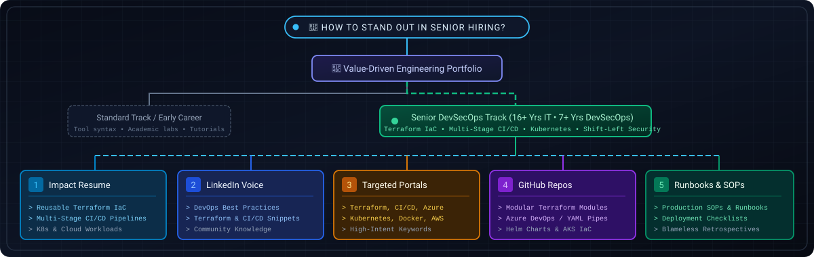
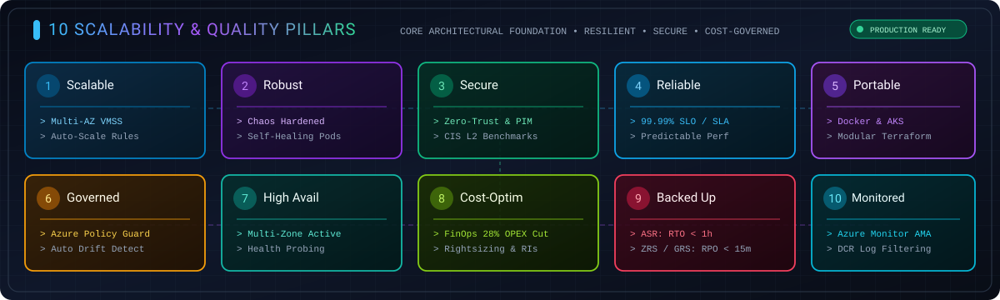
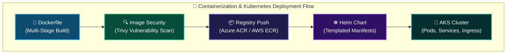
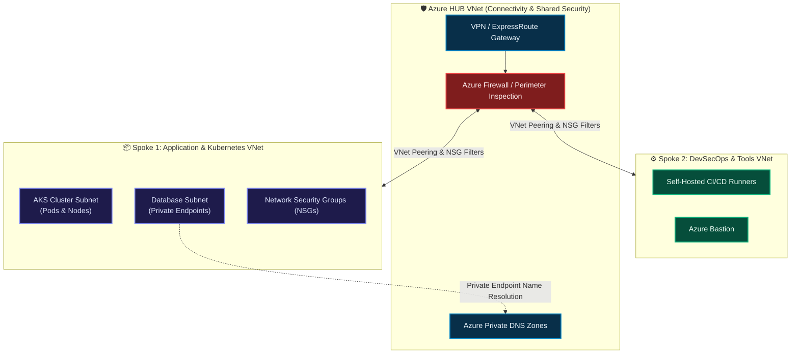
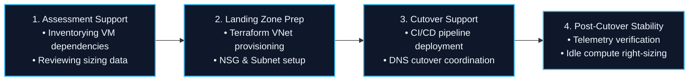

```mermaid
flowchart TD
    subgraph CorePillars ["🛠️ 10 DevSecOps & Cloud Engineering Pillars"]
        direction LR
        P1["⚡ 1. Terraform IaC<br/>• Reusable Modules<br/>• State Locking & Drift"]
        P2["🚀 2. CI/CD Pipelines<br/>• Multi-Stage YAML<br/>• PR Quality Gates"]
        P3["🐳 3. Docker Engine<br/>• Multi-Stage Builds<br/>• Non-Root Images"]
        P4["☸️ 4. Kubernetes<br/>• AKS / Pods & Ingress<br/>• Helm Charts & HPA"]
        P5["🛡️ 5. DevSecOps<br/>• Checkov & Trivy<br/>• Gitleaks Pre-Commit"]
        P6["☁️ 6. Azure Practices<br/>• VNets & Subnet NSGs<br/>• Private Endpoints"]
        P7["🔑 7. Secrets & IAM<br/>• Azure Key Vault<br/>• Managed Identities"]
        P8["📊 8. Observability<br/>• Azure Monitor / KQL<br/>• Log Analytics Alerts"]
        P9["🌐 9. Resilience & HA<br/>• Multi-AZ Scale Sets<br/>• Health Probes & DR"]
        P10["💰 10. Cost Guard<br/>• Auto Stop Idle VMs<br/>• Orphan Disk Cleanup"]
    end

    P1 <--> P2 <--> P3 <--> P4 <--> P5
    P5 <--> P6 <--> P7 <--> P8 <--> P9 <--> P10

    classDef c1 fill:#082f49,stroke:#38bdf8,stroke-width:2px,color:#f0f9ff;
    classDef c2 fill:#2e1065,stroke:#a855f7,stroke-width:2px,color:#faf5ff;
    classDef c3 fill:#064e3b,stroke:#10b981,stroke-width:2px,color:#f0fdf4;
    classDef c4 fill:#0c4a6e,stroke:#0ea5e9,stroke-width:2px,color:#f0f9ff;
    classDef c5 fill:#3b0764,stroke:#c084fc,stroke-width:2px,color:#faf5ff;
    classDef c6 fill:#451a03,stroke:#f59e0b,stroke-width:2px,color:#fffbeb;
    classDef c7 fill:#042f2e,stroke:#14b8a6,stroke-width:2px,color:#f0fdfa;
    classDef c8 fill:#1a2e05,stroke:#84cc16,stroke-width:2px,color:#f7fee7;
    classDef c9 fill:#4c0519,stroke:#f43f5e,stroke-width:2px,color:#fff1f2;
    classDef c10 fill:#042c33,stroke:#06b6d4,stroke-width:2px,color:#ecfeff;

    class P1 c1;
    class P2 c2;
    class P3 c3;
    class P4 c4;
    class P5 c5;
    class P6 c6;
    class P7 c7;
    class P8 c8;
    class P9 c9;
    class P10 c10;
```

<div align="center">

<!-- ANIMATED HERO BANNER -->


<br/>

# Sarvesh Kumar Mishra
### **Senior DevSecOps &bull; Cloud Engineer &bull; Technical Lead**
**16+ Years Total IT Experience | 7+ Years Specialized in DevSecOps, Terraform, CI/CD & Kubernetes**

[](https://www.linkedin.com/in/sarveshkumarmishra)
[](mailto:sarvesh.mishra.devsecops@gmail.com)
[](#-get-in-touch--lets-collaborate)
[](#-executive-profile--technical-focus)

<p align="center">
  <b>Automating Infrastructure as Code (Terraform) &bull; Engineering Resilient Multi-Stage CI/CD Pipelines &bull; Orchestrating Kubernetes & Docker &bull; Hardening Azure Cloud Security</b>
</p>

---

</div>

## 📌 Executive Profile & Technical Focus

I am a **Senior DevSecOps and Cloud Professional** with **16+ years of total IT industry experience**, including **7+ years dedicated to enterprise-grade DevSecOps, Infrastructure as Code (IaC), container orchestration, and multi-cloud platforms**.

My core technical strengths lie in **hands-on implementation**:
* **Infrastructure as Code:** Authoring reusable, modular, production-hardened **Terraform** configurations with remote state management and automated drift detection.
* **CI/CD Pipeline Automation:** Designing robust multi-stage pipelines in **Azure DevOps**, **GitHub Actions**, and **Jenkins** with built-in quality gates, approvals, and automated rollbacks.
* **Containerization & Orchestration:** Engineering secure **Docker** builds (multi-stage, non-root) and managing **Kubernetes (AKS / EKS)** clusters with Helm charts and Ingress routing.
* **Cloud & DevSecOps Best Practices:** Enforcing least-privilege security using **Azure Key Vault**, **Managed Identities**, Network Security Groups (NSGs), Private Endpoints, and shift-left security scanners (**Checkov, Trivy, Gitleaks**).

<br/>

<div align="center">

<!-- VIBRANT VISUAL: STRATEGIC DEVSECOPS PORTFOLIO -->


</div>

<br/>

> **Engineering Philosophy:** *"If infrastructure is built more than once, it must be codified in Terraform. If code moves to production, it must pass automated security gates. If workloads scale, they belong in resilient, containerized environments."*

---

## ⚡ Core Technical Delivery Metrics

| Area | Production Engineering Value Delivered | Primary Technologies |
|:---|:---|:---|
| **16+ Years** | Deep IT foundation across systems administration, networking, infrastructure operations, and cloud platforms | Systems & Cloud Operations |
| **7+ Years** | Hands-on DevSecOps engineering, automated pipeline design, and container orchestration | Azure DevOps, Jenkins, GitHub Actions |
| **Terraform IaC** | Modularized enterprise infrastructure provisioning with remote state locking and zero state drift | Terraform, Azure Blob / AWS S3 State |
| **CI/CD Pipelines** | Multi-stage YAML pipelines embedding shift-left security scanning, unit testing, and approval gates | Azure DevOps Pipelines, Jenkins, GitHub Actions |
| **Kubernetes & Docker** | Standardized container packaging, Helm packaging, and AKS cluster configuration with Private Endpoints | Docker, AKS, EKS, Helm 3, Ingress |
| **Security & Quality** | Pre-commit secrets detection and automated IaC vulnerability scans blocking insecure deployments | Checkov, Trivy, Gitleaks, tfsec |

---

## 🏛️ The 10 DevSecOps & Cloud Engineering Pillars

These ten pillars guide every module I write, pipeline I construct, and cluster I administer:

<div align="center">

<!-- VIBRANT VISUAL: 10 DEVSECOPS & CLOUD PILLARS -->


</div>

<br/>



---

## 🏗️ Technical Deep-Dive: Infrastructure as Code (Terraform)

I treat infrastructure as production software, adhering to strict coding standards, modular design, and automated validation:

```mermaid
flowchart LR
    T1["📦 Terraform Module Repo<br/>(Git Tagged SemVer)"] --> T2["🔍 Static Code Analysis<br/>(terraform fmt & tflint)"]
    T2 --> T3["🛡️ Security & Policy Scan<br/>(Checkov & tfsec)"]
    T3 --> T4["📋 Plan Generation<br/>(Remote State Lease Lock)"]
    T4 --> T5["👥 Approval Gate<br/>(CODEOWNERS Review)"]
    T5 --> T6["🚀 Automated Apply<br/>(Target Environment)"]

    classDef tf1 fill:#1e1b4b,stroke:#818cf8,stroke-width:2px,color:#fff;
    classDef tf2 fill:#0c4a6e,stroke:#38bdf8,stroke-width:2px,color:#fff;
    classDef tf3 fill:#064e3b,stroke:#10b981,stroke-width:2px,color:#fff;
    classDef tf4 fill:#2e1065,stroke:#a855f7,stroke-width:2px,color:#fff;
    classDef tf5 fill:#7f1d1d,stroke:#ef4444,stroke-width:2px,color:#fff;
    classDef tf6 fill:#042f2e,stroke:#14b8a6,stroke-width:2px,color:#fff;

    class T1 tf1;
    class T2 tf2;
    class T3 tf3;
    class T4 tf4;
    class T5 tf5;
    class T6 tf6;
```



### Production Terraform Best Practices Implemented:
* **Reusable & Parameterized Modules:** Standardized internal modules for VNets, Subnets, AKS Clusters, Storage Accounts, and Azure Key Vault with strict input validation.
* **Remote State & Lease Locking:** State stored securely in private Azure Blob Storage containers (with blob lease locking enabled) or AWS S3 (with DynamoDB state locking), preventing concurrent state corruptions.
* **Environment Directory Isolation:** Dedicated configurations for `dev`, `stage`, and `prod` leveraging shared modules to avoid state-file blast radius.
* **Automated Drift Detection:** Scheduled night pipelines running `terraform plan -detailed-exitcode` to immediately flag any manual modifications made in the cloud console.
* **Shift-Left IaC Security:** Pre-commit hooks running `tflint`, `terraform fmt`, and **Checkov** to prevent misconfigurations (e.g., exposed storage accounts, unencrypted disks) before PRs are created.

---

## 🚀 Technical Deep-Dive: Multi-Stage CI/CD & DevSecOps Pipelines

Automating the path from developer commit to production release using **Azure DevOps**, **GitHub Actions**, and **Jenkins**:

```mermaid
flowchart LR
    A["💻 Git Commit<br/>(Trunk-Based)"] --> B["🔍 Pre-Commit Lint<br/>(tflint & terraform fmt)"]
    B --> C["🛡️ Shift-Left Security<br/>(Checkov, Trivy, Gitleaks)"]
    C --> D["📦 Build & Package<br/>(Docker / Artifacts)"]
    D --> E["📋 Terraform / K8s Plan<br/>(Remote State Lock)"]
    E --> F["👥 Peer Review Gate<br/>(CODEOWNERS: 2+ Approvers)"]
    F --> G["🚀 Automated Deploy<br/>(Dev / Stage / Prod)"]
    G --> H["📊 Post-Deploy Probing<br/>(Health Checks & Alerts)"]

    classDef cGit fill:#4c0519,stroke:#f43f5e,stroke-width:2px,color:#ffffff;
    classDef cLint fill:#1e1b4b,stroke:#6366f1,stroke-width:2px,color:#ffffff;
    classDef cSec fill:#064e3b,stroke:#10b981,stroke-width:2px,color:#ffffff;
    classDef cBuild fill:#451a03,stroke:#f59e0b,stroke-width:2px,color:#ffffff;
    classDef cPlan fill:#2e1065,stroke:#a855f7,stroke-width:2px,color:#ffffff;
    classDef cGate fill:#7f1d1d,stroke:#ef4444,stroke-width:2px,color:#ffffff;
    classDef cApply fill:#082f49,stroke:#0284c7,stroke-width:2px,color:#ffffff;
    classDef cObs fill:#042f2e,stroke:#14b8a6,stroke-width:2px,color:#ffffff;

    class A cGit;
    class B cLint;
    class C cSec;
    class D cBuild;
    class E cPlan;
    class F cGate;
    class G cApply;
    class H cObs;
```



### DevSecOps Pipeline Safeguards:
* **Trunk-Based Branching:** Short-lived feature branches (`feature/*`, `bugfix/*`) with mandatory PR branch policies on `main`.
* **Zero Direct Push:** Direct commits and branch deletion strictly disabled on production branches.
* **Secrets Sanitization:** Automated **Gitleaks** execution in pre-commit hooks and pipeline stages to block committed credentials or API tokens.
* **Container Vulnerability Auditing:** Automated **Trivy** scans on Docker container images blocking deployment if critical CVEs are detected.
* **Stage Separation & Approval Gates:** Explicit manual approvals and environment protection rules enforced prior to production stage execution.

---

## 🐳 Technical Deep-Dive: Docker & Kubernetes (AKS / EKS)

Experience building reliable, lightweight container images and administering production Kubernetes clusters:



### Kubernetes & Container Competencies:
* **Multi-Stage Docker Builds:** Creating minimal, lean production images utilizing builder patterns, reducing attack surfaces and accelerating build times.
* **Non-Root Execution:** Hardening Dockerfiles to execute under dedicated non-root service users rather than default root privileges.
* **AKS Cluster Management:** Provisioning and maintaining Azure Kubernetes Service (AKS) clusters integrated with Azure CNI and Virtual Networks.
* **Helm 3 Packaging:** Managing application releases via structured Helm charts with dynamic `values.yaml` overlays for `dev`, `uat`, and `prod`.
* **Ingress & Traffic Routing:** Configuring Ingress Controllers (Nginx Ingress / AGIC) with TLS termination and path-based routing.
* **Resource Governance:** Enforcing CPU/Memory `requests` and `limits`, liveness/readiness health probes, and Horizontal Pod Autoscaling (HPA).

---

## ☁️ Azure Cloud & Infrastructure Best Practices

Building secure, scalable, and manageable cloud environments following Microsoft best practices:



### Cloud Engineering Controls Applied:
* **Hub-and-Spoke Network Isolation:** Clean separation between central connectivity and isolated workload VNets using peered VNets and NSG micro-segmentation.
* **Private Endpoints for PaaS:** Restricting Azure Key Vault, Azure SQL, and Azure Storage traffic strictly within the private virtual network, eliminating public internet access.
* **Zero Hardcoded Secrets:** Enforcing Azure Key Vault integration with **Managed Identities** (System-Assigned & User-Assigned) across VMSS and AKS workloads.
* **Operational Observability:** Centralizing container logs and infrastructure metrics into Azure **Log Analytics Workspaces** using KQL queries and Azure Monitor metric alert rules.
* **Cloud Cost Hygiene:** Automated scripts and runbooks to identify unattached managed disks, prune stale snapshots, and shut down non-production resources on weekends.

---

## 🧭 Supporting Foundation: Migration & Operational Awareness

While my core day-to-day focus is **hands-on DevSecOps, Terraform, and CI/CD engineering**, I bring valuable cross-functional experience supporting enterprise migration and cost-efficiency initiatives:



* **Workload Cutover Support:** Collaborating with application teams to provision target environments via Terraform and execute automated deployment scripts during scheduled maintenance windows.
* **Practical FinOps Awareness:** Partnering with team leads to right-size oversized compute instances, clean up orphaned resources, and leverage non-production schedules.

---

## 🛠️ Comprehensive Technical Skill Spectrum

<div align="center">

### Infrastructure as Code & Automation


### CI/CD, DevSecOps & Security Tools


### Containers & Orchestration

-326CE5?style=for-the-badge&logo=kubernetes&logoColor=white)


### Cloud Platforms & Enterprise Networking


### Identity, Observability & Scripting


</div>

---

## 📂 Featured Production Blueprints & Repositories

Explore hands-on modular templates, CI/CD pipelines, and infrastructure modules:

<table>
  <tr>
    <td width="50%">
      <h3>🏛️ <a href="https://github.com/Sarvesh0401/terraform-azure-landing-zone">terraform-azure-landing-zone</a></h3>
      <p>Modular, reusable Terraform configuration for provisioning Azure VNets, Subnets, NSGs, and Private Endpoints with remote state locking and tflint validation.</p>
      <code>Terraform</code> &bull; <code>Azure</code> &bull; <code>Hub-and-Spoke</code> &bull; <code>IaC</code>
    </td>
    <td width="50%">
      <h3>🛡️ <a href="https://github.com/Sarvesh0401/devsecops-pipeline-accelerator">devsecops-pipeline-accelerator</a></h3>
      <p>Ready-to-use Azure DevOps and GitHub Actions YAML multi-stage pipelines integrating Checkov, Trivy, and Gitleaks shift-left security checks before deployment gates.</p>
      <code>CI/CD</code> &bull; <code>Checkov</code> &bull; <code>Trivy</code> &bull; <code>YAML</code>
    </td>
  </tr>
  <tr>
    <td width="50%">
      <h3>☸️ <a href="https://github.com/Sarvesh0401/aks-helm-deployment-starter">aks-helm-deployment-starter</a></h3>
      <p>Production-ready Helm 3 chart and Kubernetes manifests for microservices on AKS with Ingress routing, health probes, and resource limit baselines.</p>
      <code>Kubernetes</code> &bull; <code>AKS</code> &bull; <code>Helm</code> &bull; <code>Docker</code>
    </td>
    <td width="50%">
      <h3>💰 <a href="https://github.com/Sarvesh0401/azure-cleanup-automation">azure-cleanup-automation</a></h3>
      <p>Automated PowerShell and Azure CLI runbooks to locate unattached managed disks, purge stale snapshots, and stop non-production VMs on weekends.</p>
      <code>PowerShell</code> &bull; <code>Azure CLI</code> &bull; <code>Cost Hygiene</code> &bull; <code>Automation</code>
    </td>
  </tr>
</table>

---

## 📊 GitHub Analytics & Engineering Pulse

<div align="center">


<br/>


</div>

---

## 🤝 Get in Touch & Let's Collaborate

Whether you are looking for an experienced **Senior DevSecOps Engineer**, a **Terraform & CI/CD Specialist**, or a solid practitioner to streamline container pipelines and cloud infrastructure:

<div align="center">

[](https://www.linkedin.com/in/sarveshkumarmishra)
[](mailto:sarvesh.mishra.devsecops@gmail.com)
[](https://github.com/Sarvesh0401)

<br/>

```
"Code it in Terraform. Automate it in Pipelines. Secure it Continuously."
```

**Crafted with 🛡️ by Sarvesh Kumar Mishra**

</div>
